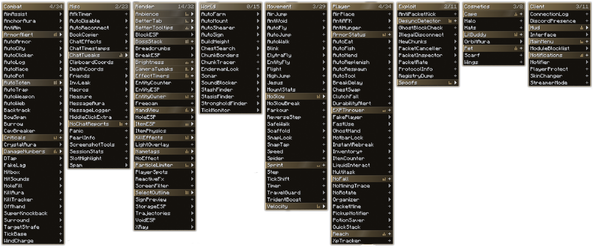
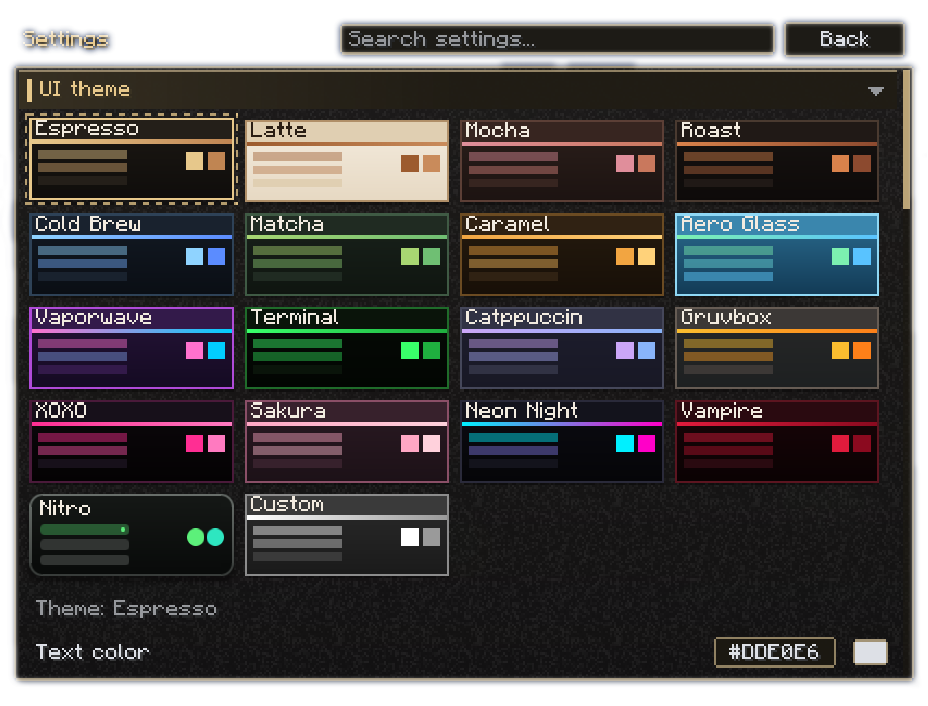
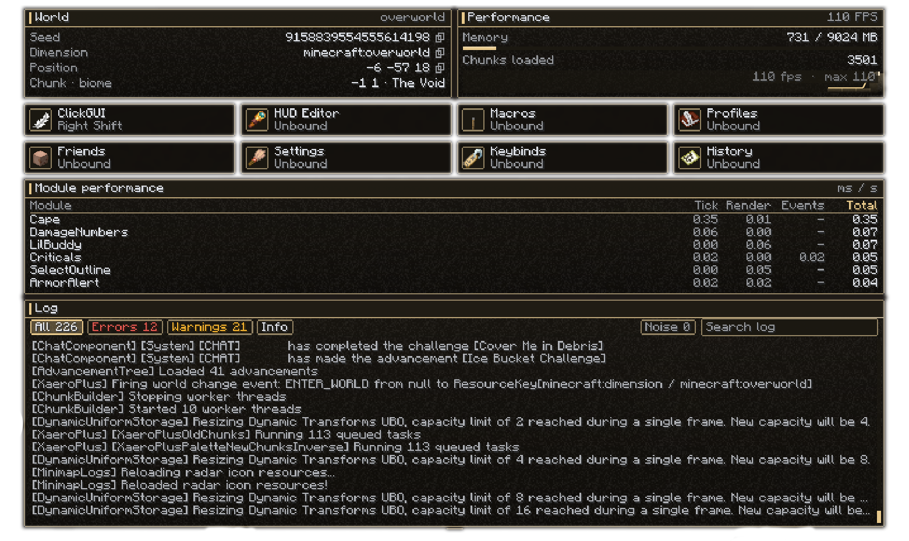

<p align="center">
  
</p>

<p align="center">
  Coffee Client is an open-source utility mod for Minecraft 26.2 that adds a customizable interface
  and 197 high-quality modules across nine categories.
</p>

<p align="center">
  
  
  
  
  
</p>

<p align="center">
  Inspired by Meteor Client.
</p>

---

| | |
|---|---|
| Mod ID / package | `coffeeclient` / `dev.coffeeclient` |
| Minecraft | 26.2 (unobfuscated, no mappings) |
| Loader / API | Fabric Loader ≥ 0.18.4 (built against 0.19.5), Fabric API `0.161.0+26.2` |
| Build | Gradle 9.7.1 wrapper, Fabric Loom 1.18.4, Java 25 |
| Side | Client only (`"environment": "client"`) |
| Licence | GNU GPL v3.0 (`LICENSE`) |

## Preview

<p align="center">
  
</p>

<p align="center">
  
  
</p>

## Build and run

```bash
./gradlew build              # jar in build/libs/
./gradlew runClient          # dev client
./gradlew test               # unit tests
./gradlew runClientGameTest  # in-game checks (needs an unlocked desktop)
```

Java 25 is required. If only a Java 25 JRE is installed, the foojay toolchain resolver in
`settings.gradle` downloads a JDK automatically.

`./gradlew runClient -PdevTour` is a smoke test: it creates or reopens the `CoffeeTour` world, opens
every screen, writes screenshots to `run/screenshots/`, and quits.

## Deploy to a test profile

```bash
./gradlew deployToTestProfile
```

This builds the jar, removes older copies of this mod from `<testProfileDir>/mods/`, and copies the new
one in. Nothing else in the profile is read, changed or deleted. Set the path with `testProfileDir` in
`gradle.properties`, or override it:

```bash
./gradlew deployToTestProfile -PtestProfileDir="/path/with spaces/My Profile"
```

The profile needs Minecraft 26.2 + Fabric Loader and the matching Fabric API `0.161.x+26.2` jar.

## Keybinds

Global keys appear under *Coffee Client* in vanilla Controls and can be rebound in
**Settings → Keybinds**.

| Action | Default |
|---|---|
| Open dashboard | Right Shift |
| Open ClickGUI | Right Ctrl |
| HUD editor, macros, profiles, friends, settings, keybinds, history | Unbound |

Module keys are unbound by default and are set in **Settings → Module keybinds** or from a module's
ClickGUI keybind row. Any binding can use a keyboard key or a mouse button, and **Esc** closes any
client screen.

- **ClickGUI:** left-click toggles a module, right-click (or `+`) expands settings, drag headers to move
  columns, type to search.
- **HUD editor:** drag elements (they snap to edges and a 4 px grid), right-click to hide one, `R` to
  reset the layout.

## Configuration

| File | Contents |
|---|---|
| `config/coffeeclient/config.json` | theme, mod options, modules, HUD layout |
| `config/coffeeclient/friends.json` | friend list |
| `config/coffeeclient/macros.json` | macros |
| `config/coffeeclient/profiles.json` | saved profiles |
| `config/coffeeclient/chatlogs/<date>.log` | chat history (*MessageLogger*) |

Saves are debounced, written through a temp file with an atomic rename, and a corrupt file is moved
aside as `*.corrupt-<timestamp>` and replaced with defaults.

## Adding a module

Create a class under `module/modules/<category>/` and add it to `ModuleManager.createModules()`:

```java
public final class AutoWave extends Module {
	public final BooleanSetting loud = setting(new BooleanSetting("Loud", "Wave harder", false));

	public AutoWave() {
		super("AutoWave", Category.MISC, "Waves at nearby players.");
	}

	@Override public void onTick() { /* runs every client tick while enabled */ }
}
```

The module then appears in the ClickGUI and Settings, and its state and settings are saved
automatically. Override `onEnable` / `onDisable` as needed, or subscribe to events through
`CoffeeClient.events()`.

## Architecture

```
core/     entrypoint, event bus, keybinds
module/   module base, manager, modules/<category>
setting/  typed settings
gui/      screens, widgets, theme, animations
hud/      HUD manager and elements
config/   config and profiles
util/     shared helpers
mixin/    one mixin per hook point, delegating to modules
```
